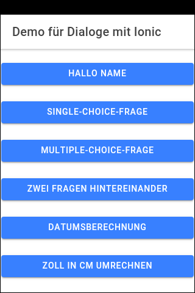
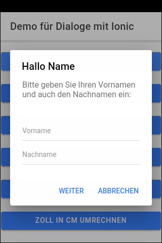
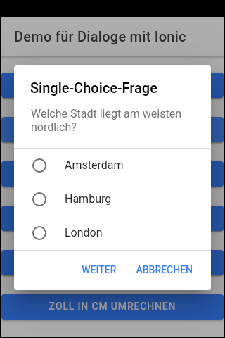
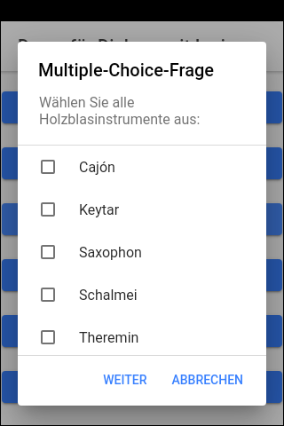
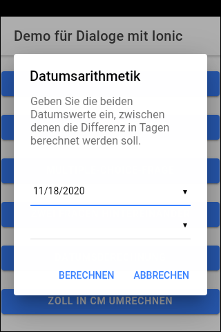
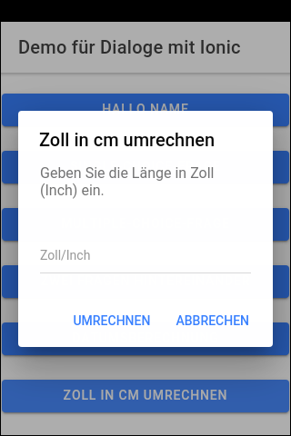

# Ionic-App "Dialog-Demo" #

 

Diese Repository enthält ein [Ionic](https://ionicframework.com/)/Angular-Projekt für eine mobile App.
Die App dient der Demonstration verschiedener Möglichkeiten mit Dialogen, welche im Ionic-Framework
[Alert](https://ionicframework.com/docs/api/alert) genannt werden.

 

----

## Screenshots ##

 

 &nbsp; 

 &nbsp; 

 &nbsp; 

 

----

## License ##

 

See the [LICENSE file](LICENSE.md) for license rights and limitations (BSD 3-Clause License) for the
files in this repository.

 
